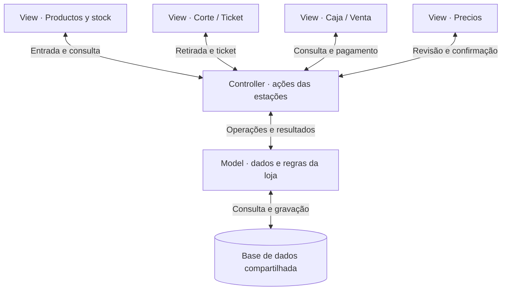
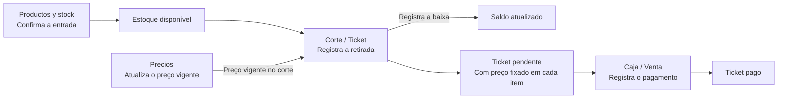

# Telas el Regalo

Telas el Regalo é um projeto de sistema para a operação de uma loja de tecidos. A proposta é acompanhar a mercadoria da entrada em estoque até o corte ou a retirada, o ticket e o pagamento. A operação foi planejada para funcionar localmente, mesmo sem internet.

Este repositório reúne a documentação inicial do projeto. Os nomes das estações seguem o menu da aplicação, em espanhol.

## Estações de trabalho

| Estação | O que faz | Como usa a base compartilhada |
| --- | --- | --- |
| **Productos y stock** | Consulta produtos e saldos, cadastra produtos com preço inicial e confirma entradas de mercadoria. | Registra produtos e entradas. O estoque confirmado fica disponível para Corte / Ticket. |
| **Corte / Ticket** | Consulta a disponibilidade e registra a retirada da mercadoria e os itens do atendimento. | Atualiza o saldo, registra a movimentação e salva no item do ticket o preço unitário vigente no momento do corte. |
| **Caja / Venta** | Consulta o ticket pendente e registra seu pagamento. | Usa os valores dos itens do ticket. A base calcula o total da venda, e o pagamento não gera outra baixa de estoque. |
| **Precios** | Permite revisar e confirmar alterações nos preços de produtos existentes em uma área protegida por PIN. | Atualiza o preço vigente e registra o histórico. Os preços já gravados nos tickets são preservados. |

## Arquitetura MVC — Model, View, Controller

Cada estação tem uma responsabilidade operacional. **Model, View e Controller** são papéis dentro da aplicação que atendem às quatro estações.

- **View (Visão)** é a tela que a equipe usa para consultar informações, preencher formulários e conferir o resultado.
- **Controller (Controlador)** recebe a ação da tela, valida a entrada e a autorização quando exigida, aciona a operação no modelo e devolve o resultado à tela.
- **Model (Modelo)** representa os dados e as regras da loja, como estoque, preços, tickets e vendas. Ele usa a base de dados compartilhada para consultar e registrar as operações.

### Da entrada ao pagamento

No estoque, metros (`m`) são controlados por rolo, quilos (`kg`) por peça física e unidades (`un`) pelo saldo inteiro de cada produto. O histórico de movimentações permite acompanhar como as entradas e retiradas alteraram o saldo.

Os diagramas mostram as responsabilidades e o caminho dos dados. A operação local e as regras descritas aqui seguem o planejamento do projeto. O tratamento excepcional de um ticket cortado e não pago ainda está em aberto.
