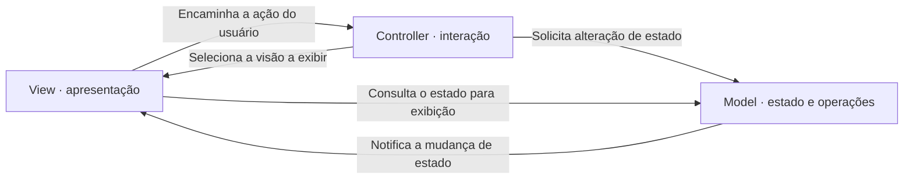
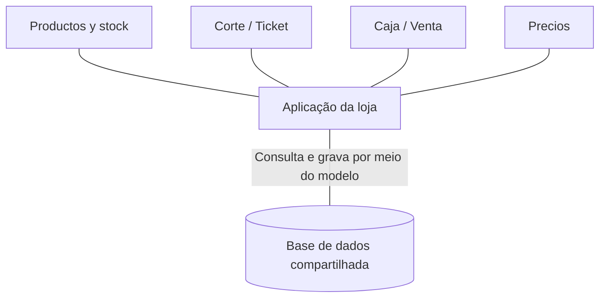
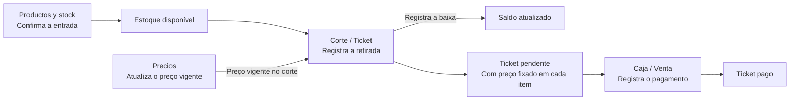

# Telas el Regalo

Telas el Regalo é um projeto de sistema para a operação de uma loja de tecidos. A proposta é acompanhar a mercadoria da entrada em estoque até o corte ou a retirada, o ticket e o pagamento. A operação foi planejada para funcionar localmente, mesmo sem internet.

Este repositório reúne a documentação inicial do projeto. Os nomes das estações seguem o menu da aplicação, em espanhol.

## Estações de trabalho

| Estação | O que faz | Como usa a base compartilhada |
| --- | --- | --- |
| **Productos y stock** | Consulta produtos e saldos, cadastra produtos com preço inicial e confirma entradas de mercadoria. | Registra produtos e entradas. O estoque confirmado fica disponível para Corte / Ticket. |
| **Corte / Ticket** | Consulta a disponibilidade e registra a retirada da mercadoria e os itens do atendimento. | Atualiza o saldo, registra a movimentação e salva no item do ticket o preço unitário vigente no momento do corte. |
| **Caja / Venta** | Consulta o ticket pendente e registra seu pagamento. | Usa os valores dos itens do ticket. A base calcula o total da venda, e o pagamento não gera outra baixa de estoque. |
| **Precios** | Permite revisar e confirmar alterações nos preços de produtos existentes em uma área protegida por PIN. | Atualiza o preço vigente e registra o histórico. Os preços já gravados nos tickets são preservados. |

## Arquitetura MVC — Model, View, Controller

O MVC separa o estado da aplicação e suas operações da apresentação e do tratamento das ações do usuário.

- **Model (Modelo)** mantém o estado e as operações do domínio, como registrar retiradas de estoque e pagamentos.
- **View (Visão)** apresenta o estado ao usuário e encaminha as interações ao controlador.
- **Controller (Controlador)** interpreta as interações, solicita operações ao modelo e seleciona a visão a exibir.

### Ciclo de interação no MVC

O diagrama adapta a organização conceitual da Figura 6.5 de Ian Sommerville. Cada seta indica uma interação e sua direção.

Ao receber uma ação que altera dados, o controlador solicita a operação ao modelo. No padrão conceitual, o modelo notifica a visão da mudança e a visão consulta o estado para atualizar a apresentação. O controlador também pode selecionar outra visão conforme a ação.

### Aplicação no Telas el Regalo

Na aplicação web, as rotas recebem as requisições e selecionam a página de resposta. Por exemplo, após registrar um pagamento, **Caja / Venta** redireciona o navegador para a página do ticket. A nova requisição consulta o registro atualizado e renderiza a página com o resultado. A notificação do diagrama conceitual descreve o padrão do livro. Neste fluxo, a tela se atualiza por requisição HTTP.

O mapa abaixo mostra como as estações usam a mesma base por meio da aplicação. As linhas representam dependências de uso.

**Referência** · Ian Sommerville. *Software Engineering*. 10ª edição, edição global. Pearson, cap. 6, seção 6.3, figuras 6.4 a 6.6. [Capítulo 6 · material do autor](https://www.slideshare.net/slideshow/ch6-architectural-design/43151507).

### Da entrada ao pagamento

No estoque, metros (`m`) são controlados por rolo, quilos (`kg`) por peça física e unidades (`un`) pelo saldo inteiro de cada produto. O histórico de movimentações permite acompanhar como as entradas e retiradas alteraram o saldo.

Os diagramas mostram as responsabilidades e o caminho dos dados. A operação local e as regras descritas aqui seguem o planejamento do projeto. O tratamento excepcional de um ticket cortado e não pago ainda está em aberto.
