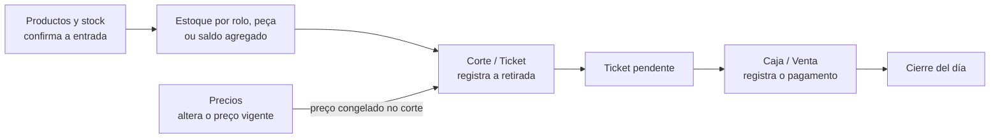
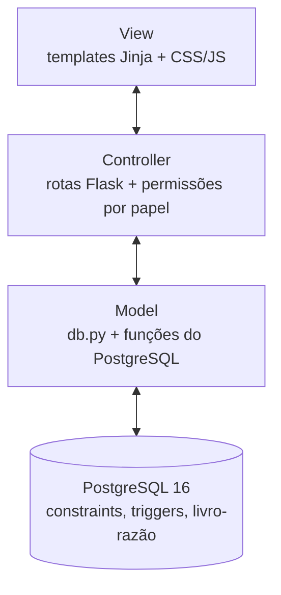

# Urdimbre

Sistema local-first de estoque, corte e caixa para lojas de tecidos, com rastreabilidade do rolo até a venda.

> **Urdimbre** é um nome fictício. O sistema foi desenvolvido para uma loja de tecidos real, cujo nome foi removido desta cópia pública. A interface está em espanhol da Argentina (es-AR), idioma da operação da loja.

## O problema

Uma loja de tecidos vende por metro, por quilo e por unidade. Saber "quanto tem em estoque" não basta: 30 m divididos em três rolos de 10 m não atendem um pedido de 12 m contínuos. E o que foi cortado nem sempre é exatamente o que foi cobrado.

O sistema acompanha o caminho físico e financeiro da mercadoria:



## Destaques técnicos

- **Regras no banco, não só na aplicação.** Saldo, alocações por rolo, total da venda e fechamento diário são garantidos por funções, constraints e triggers do PostgreSQL. Uma tela com defeito não consegue gravar um estado inválido.
- **Três modelos de estoque.** `m`: cada rolo é individual, com saldo próprio. `kg`: cada peça é individual. `un`: saldo inteiro agregado por produto.
- **Vendido ≠ cortado.** As duas quantidades são registradas separadamente; o valor usa a vendida, a baixa usa a cortada.
- **Idempotência e concorrência.** Toda operação que grava usa chave de idempotência, `SELECT ... FOR UPDATE` e advisory locks; há testes de concorrência com sessões reais.
- **Papéis em três camadas.** Administrador, Empleado e Cajero: o menu mostra só o permitido, as rotas recusam o resto e as funções do banco conferem o papel como segunda barreira.
- **Operação local.** Funciona sem internet. Vários computadores usam um servidor na rede local pelo navegador; conexões de fora de redes privadas são recusadas.
- **Backup e recuperação.** Backup verificado com `pg_dump` a cada hora e a cada fechamento; recuperação em outro computador em um passo, testada de ponta a ponta contra um segundo PostgreSQL; nunca substitui uma base existente.
- **Segredos fora do repositório.** A senha de conexão fica cifrada pelo Windows (DPAPI) para a conta que usa a loja.

## Arquitetura (MVC)



| Camada | Onde | Responsabilidade |
| --- | --- | --- |
| View | `app_loja/templates`, `app_loja/static` | Telas e formulários |
| Controller | `app_loja/routes`, `app_loja/permisos.py` | Valida entrada e papel, chama o modelo |
| Model | `app_loja/db.py`, `schema.sql` | Dados e regras de negócio |

A aplicação conecta ao banco com uma role restrita: não lê hashes de senha nem altera tabelas diretamente; opera apenas por funções controladas.

## Papéis

| Área | Administrador | Empleado | Cajero |
| --- | :---: | :---: | :---: |
| Productos / Stock | sim | sim | não |
| Corte / Ticket | sim | sim | sim |
| Caja / Venta e Consulta de Caja | sim | não | sim |
| Cierre del día e Fondo inicial | sim | não | sim |
| Precios | sim | não | não |

## Testes

A suíte roda contra um PostgreSQL temporário criado e apagado pelo próprio runner; nunca toca uma base instalada.

- Testes SQL funcionais e de concorrência do núcleo.
- Testes de integração HTTP com banco real para cada fluxo: entrada de estoque, corte, caixa, fechamento, preços e fotos.
- Matriz de papéis verificada por menu, endereço direto, formulário forjado e direto no banco.
- Instalação, backup e restauração testados com autenticação SCRAM real.

```powershell
.\ejecutar_pruebas.bat
```

## Rodar a demonstração

Requisitos: Windows, Python 3.13 e PostgreSQL 16 instalados.

```powershell
python -m venv .venv-windows
.\.venv-windows\Scripts\python.exe -m pip install -r .\app_loja\requirements.txt
.\demo.bat
```

A demonstração cria um PostgreSQL temporário com dados fictícios, abre a loja em `http://127.0.0.1:5050` e apaga tudo ao fechar. As contas e a senha da demonstração aparecem na janela.

Para uma instalação de verdade, veja [docs/INSTALACAO_WINDOWS.md](docs/INSTALACAO_WINDOWS.md).

## Estrutura

| Caminho | Conteúdo |
| --- | --- |
| `app_loja/` | Aplicação Flask (rotas, templates, validação, instalação, backup) |
| `schema.sql` | Esquema, funções de negócio, permissões |
| `tests/` | Suíte Python, SQL e runner Windows |
| `docs/decisions/` | Decisões confirmadas, com data e consequências |
| `docs/planning/` | Planos de cada entrega |
| `HANDOFF.md`, `ROADMAP.md` | Regras de domínio e fases do projeto |

## Stack

Python 3.13 · Flask · PostgreSQL 16 (PL/pgSQL) · psycopg2 · Pillow · waitress · unittest

## Limites conhecidos

- As três contas são compartilhadas por papel: o sistema sabe qual papel fez a operação, não qual pessoa.
- Na rede local a conexão não é cifrada; o modo servidor pressupõe uma rede exclusiva da loja.
- Acesso remoto por VPN, relatórios e tratamento de ticket cortado e não pago ainda não foram implementados.
- O instalador e os scripts são para Windows; o caminho Linux é só de desenvolvimento.

## Como foi desenvolvido

Projeto desenvolvido com apoio de assistentes de IA, conduzido por regras de domínio e decisões registradas em `HANDOFF.md` e `docs/decisions/`.
